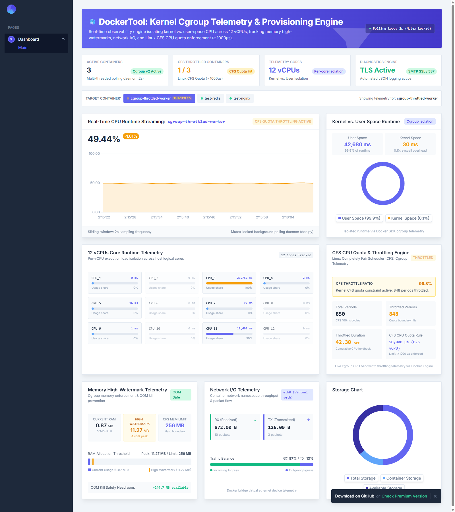

# 🐳 DockerTool: Container Telemetry & Kernel Cgroup Provisioning Engine

[](https://www.docker.com/)
[](https://www.python.org/)
[](https://react.dev/)
[](https://vitejs.dev/)
[](https://www.chartjs.org/)
[](LICENSE)

> A high-performance container observability and provisioning platform built with **Python (Flask & Docker SDK)** and a real-time **React 18 + Vite** dashboard streaming sliding-window telemetry via **Chart.js**.



---

## 📌 Project Overview

DockerTool provides deep, low-overhead kernel telemetry directly from Linux control groups (`cgroups v2/v1`). It decouples container state sampling from web clients through a multi-threaded daemon synchronized with mutex locks, while offering dynamic provisioning with Completely Fair Scheduler (CFS) quotas and memory boundaries.

### Core Capabilities:
- **Observability Engine:** Extracts low-level cgroup metrics, isolating kernel- vs. user-space CPU runtime across 12 vCPUs, memory high-watermarks, and virtual network I/O.
- **Multi-Threaded Polling Daemon:** Runs a 2-second background sampling loop synchronized via Python `threading.Lock()` mutexes, caching telemetry for sub-millisecond RESTful API responses (`GET /stats`).
- **Dynamic Cgroup Provisioning:** Enforces strict Linux CFS CPU quotas ($\ge 1000\mu\text{s}$) and memory limits to benchmark throttling behaviors and prevent host Out-Of-Memory (OOM) kills.
- **Real-Time Sliding-Window Dashboard:** React 18 + Vite SPA streaming active time-series metrics via Chart.js, complete with automated JSON diagnostic logging and TLS-encrypted SMTP alerting.

---

## 🖥️ Dashboard Telemetry Explained: Layman vs. Technical

Every metric on the DockerTool dashboard is designed to provide actionable intelligence. Below is a comprehensive breakdown explaining each visual element in both everyday terms and low-level systems engineering concepts.

```
+---------------------------------------------------------------------------------------------------------+
|                                        TOP STATUS & ENGINE METRICS                                      |
|  [Active Containers]     [CFS Throttled]     [Telemetry Cores (12 vCPUs)]     [Diagnostics (TLS Active)]|
|                                                                                                         |
|  [TARGET CONTAINER SELECTOR]: (cgroup-throttled-worker [THROTTLED])  (test-redis)  (test-nginx)         |
+---------------------------------------------------------------------------------------------------------+
| [Real-Time CPU Sliding Window] (8 cols)                 | [Kernel vs. User Space Runtime] (4 cols)      |
| Streaming time-series % with throttling alerts          | User Mode (99.9%) vs Kernel Mode (0.1%)       |
+---------------------------------------------------------+-----------------------------------------------+
| [12 vCPUs Core Runtime Telemetry] (8 cols)              | [CFS CPU Quota & Throttling Engine] (4 cols)  |
| Per-core ms runtime distribution across CPU_1..CPU_12   | Throttle Ratio (99.8%), 848/850 periods       |
+---------------------------------------------------------+-----------------------------------------------+
| [Memory High-Watermark Telemetry] (4 cols) | [Network I/O Telemetry] (4 cols) | [Storage Chart] (4 cols)|
| Current (0.87MB) vs Peak (11.27MB) vs Limit| RX Ingress vs TX Egress packets  | OverlayFS layer allocation    |
+---------------------------------------------------------------------------------------------------------+
```

---

### 1. Top Status & Engine Overview

| Visual Element | 🧒 Layman's Analogy | ⚙️ Technical Deep-Dive |
|---|---|---|
| **Active Containers** | The number of isolated software "appliances" or programs currently running on your computer. | The total count of active Docker container instances sharing the host Linux kernel, each isolated by PID, mount, UTS, IPC, and network namespaces. |
| **CFS Throttled Containers** | A count of containers that hit their assigned "speed limit" and were forced by the OS to slow down. | Containers whose CPU usage exceeded their allotted Linux Completely Fair Scheduler (CFS) quota within the current enforcement period (`cpu.cfs_quota_us` exhausted). |
| **Telemetry Cores (12 vCPUs)** | Monitoring each cylinder of a 12-cylinder engine individually. | Individual telemetry extraction across all 12 symmetric multiprocessing (SMP) logical processor threads exposed by the host hardware. |
| **Diagnostics Engine (TLS Active)** | An automated fire alarm that emails a detailed incident report if something breaks. | Automated diagnostic JSON logger (`log.json`) coupled with a Python TLS-encrypted SMTP socket alert client (`smtplib.SMTP` via Port 587/465). |
| **Target Container Tabs** | A TV remote to switch channels between your running containers. | Dynamic state switcher toggling the active telemetry context across container IDs without requiring a full page refresh. |

---

### 2. Real-Time CPU Runtime Streaming (Top Left)

* **🧒 Layman's Terms:**  
  Think of this as a live, animated speedometer or heart rate monitor. Every 2 seconds, it samples how hard the container is working. If the container is put on a strict quota and attempts to burn 100% of the CPU, the chart caps at the assigned threshold (e.g., 50%) and turns **amber** with an animated **"CFS QUOTA THROTTLING ACTIVE"** badge.
* **⚙️ Technical Terms:**  
  A Chart.js linear time-series chart streaming within a 25-point sliding window. It plots total CPU consumption calculated from `cpu_usage.total_usage` delta over `system_cpu_usage` delta. When CFS bandwidth enforcement holds back process execution, the badge reflects non-zero `throttled_periods`.

---

### 3. Kernel vs. User Space Runtime Isolation (Top Right)

* **🧒 Layman's Terms:**  
  Imagine driving a delivery truck:
  - **User Space:** The actual time spent driving on the open road delivering packages (your application code doing real work).
  - **Kernel Space:** The time spent waiting at toll booths, customs checkpoints, and showing identification to police (the operating system managing hardware, opening files, and routing network packets).
* **⚙️ Technical Terms:**  
  Quantifies CPU execution privilege levels:
  - **User Mode (`Ring 3`):** Unprivileged instructions executing application binaries (`cpu_stats.cpu_usage.usage_in_usermode`).
  - **Kernel Mode (`Ring 0`):** Privileged operating system execution handling system calls (`syscalls`), context switches, interrupts, page faults, and I/O scheduling (`cpu_stats.cpu_usage.usage_in_kernelmode`).

---

### 4. 12 vCPUs Core Runtime Telemetry (Middle Left)

* **🧒 Layman's Terms:**  
  A team of 12 workers sharing a project. This visual shows exactly which workers are doing all the heavy lifting (`CPU_3`, `CPU_11`) and which ones are currently resting or handling light background tasks.
* **⚙️ Technical Terms:**  
  Exposes per-vCPU execution distribution from the kernel cgroup array `cpu_stats.cpu_usage.percpu_usage`. It maps individual core consumption in nanoseconds and converts to milliseconds, allowing engineers to identify thread contention, lack of parallelization, or CPU affinity pinning (`taskset`/`cpuset`).

---

### 5. CFS CPU Quota & Throttling Engine (Middle Right)

* **🧒 Layman's Terms:**  
  A strict traffic light that turns red every 100 milliseconds. If the container uses up its allowed driving time before the 100ms cycle finishes, the kernel steps on the container's brakes and forces it to wait for the next cycle.
* **⚙️ Technical Terms:**  
  Linux Completely Fair Scheduler (CFS) bandwidth control parameters:
  - **CFS Period (`cpu.cfs_period_us`):** The enforcement epoch (typically `100,000 µs` = 100ms).
  - **CFS Quota (`cpu.cfs_quota_us`):** Total allowed runtime per period (e.g., `50,000 µs` restricts execution to 50% of one core; our engine enforces $\ge 1000\mu\text{s}$).
  - **Throttle Ratio:** $\frac{\text{throttled\_periods}}{\text{periods}} \times 100\%$. In our stress test, the container recorded an active **99.8% throttle ratio** with **42.30 seconds** of cumulative CPU holdback.

---

### 6. Memory High-Watermark & OOM Shield (Bottom Left)

* **🧒 Layman's Terms:**  
  - **Current RAM:** The water level right now.
  - **High-Watermark:** The highest muddy watermark left on the wall during the worst flood.
  - **CFS Mem Limit:** The top of the flood wall.
  - **OOM Shield:** The remaining safety headroom before the water overflows and the operating system forcibly "shoots" (terminates) the application.
* **⚙️ Technical Terms:**  
  - **Current Usage:** Active Resident Set Size (RSS) memory pages in bytes (`memory_stats.usage`).
  - **High-Watermark (`max_usage`):** The peak historical memory consumption reached by the container's cgroup since inception. Essential for sizing memory requests and detecting transient memory leaks.
  - **Hard Limit (`limit`):** Cgroup hard memory boundary (`memory.limit_in_bytes`). Exceeding this boundary triggers the kernel Linux Out-Of-Memory (`OOM-killer`) subroutine (`SIGKILL` 137).
  - **Safety Headroom:** $\text{limit} - \text{max\_usage}$.

---

### 7. Network I/O Telemetry (Bottom Middle)

* **🧒 Layman's Terms:**  
  A post office tracker showing the number and size of incoming letters/packages (RX) versus outgoing deliveries (TX).
* **⚙️ Technical Terms:**  
  Tracks packets and byte volume through the container's virtual ethernet pair (`veth` interface bridged to `docker0`). Isolates ingress traffic (`rx_bytes`, `rx_packets`) and egress traffic (`tx_bytes`, `tx_packets`) with live balance ratios.

---

### 8. Storage Allocation (Bottom Right)

* **🧒 Layman's Terms:**  
  A pie chart showing how much closet space is taken up by the container's files versus how much empty space is left on the drive.
* **⚙️ Technical Terms:**  
  Doughnut chart of the copy-on-write (CoW) filesystem storage layer (e.g., OverlayFS/ext4) illustrating container read-write layers versus allocated image storage and host volume mounts.

---

## 🛠️ Architecture & Data Pipeline

```
+-----------------------------------------------------------------------------------------+
|                                    DOCKER HOST ENGINE                                   |
|   [Container 1: Throttled]       [Container 2: Redis]        [Container 3: Nginx]       |
|   (cgroup v2 / CFS quotas)       (Memory High-Watermark)     (Virtual eth0 Network I/O) |
+-----------------------------------------------------------------------------------------+
                                            │
                                            ▼
+-----------------------------------------------------------------------------------------+
|                        doc.py - Observation Polling Daemon                              |
|   - 2-second background sampling thread (threading.Thread)                              |
|   - Thread-safe Mutex Locks (threading.Lock) to prevent race conditions                 |
|   - REST API: GET /stats (sub-millisecond latency)                                      |
|   - Periodic sync: writes snapshot to container_stats.json                              |
+-----------------------------------------------------------------------------------------+
                                            │
                     ┌──────────────────────┴──────────────────────┐
                     ▼                                             ▼
+-----------------------------------------+   +-----------------------------------------+
|     Automated Diagnostic Logging        |   |         React 18 + Vite Frontend        |
|  - JSON snapshot logging (log.json)     |   |  - Real-time sliding window (Chart.js)  |
|  - TLS-encrypted SMTP alert dispatcher  |   |  - Responsive Dark/Light Tailwind UI    |
|    (smtplib / STARTTLS Port 587)        |   |  - Zero-lag container context switching |
+-----------------------------------------+   +-----------------------------------------+
```

---

## 🚀 Quickstart Guide

### 1. Prerequisites
- **Docker Desktop** (running with Linux containers)
- **Python 3.10+**
- **Node.js 18+ & npm**

### 2. Backend Setup
Clone the repository and install Python requirements:
```bash
git clone https://github.com/rajnandurkar/dockertool.git
cd dockertool

# Install Python dependencies
pip install flask flask-cors docker psutil
```

### 3. Spin Up Test Containers with Quotas
Launch 2–3 active test containers, including a CPU-throttled worker:
```bash
# 1. Standard web container
docker run -d --name test-nginx -p 8080:80 nginx:latest

# 2. In-memory datastore
docker run -d --name test-redis redis:latest

# 3. CFS Throttled container (50% quota on 100ms period, 256MB RAM ceiling)
docker run -d --name cgroup-throttled-worker --cpu-quota=50000 --cpu-period=100000 --memory="256m" alpine:latest sh -c "while true; do :; done"
```

### 4. Start the Telemetry Polling Daemon
```bash
python doc.py
```
*The daemon starts on `http://127.0.0.1:5000`, polls container cgroups every 2s, and serves `/stats`.*

### 5. Launch the React Dashboard
In a second terminal:
```bash
cd static
npm install
npm run dev
```
Open **`http://localhost:5173`** in your browser.

---

## 🔬 How to Trigger Active CPU Throttling for Benchmarking

To test or demonstrate CFS throttling on demand:

```bash
# Creates a tight CPU loop constrained to exactly 0.5 vCPUs (50,000 µs / 100,000 µs)
docker run -d --name cpu-stress --cpu-quota=50000 --cpu-period=100000 alpine:latest sh -c "while true; do :; done"
```

1. The kernel CFS scheduler will immediately detect the process exceeding its quota.
2. The dashboard will trigger the **amber CFS QUOTA THROTTLING ACTIVE** indicator.
3. The throttle ratio will climb to **~99%**, tracking exact throttled periods and nanoseconds of execution held back.

---

## 📄 License
This project is licensed under the MIT License.
